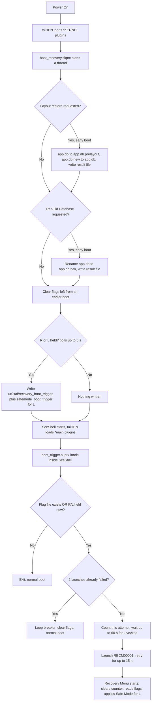

# PS Vita Recovery Menu Project

A diagnostic and recovery environment for the PlayStation Vita with plugin repair tools, storage diagnostics, and boot-time recovery via R trigger.

Hi! I'm Jose (@DrinkingSubset), and this is my first major homebrew project for the PS Vita.

I want to be completely transparent from the start:

I'm **not a full-time or professional developer**. For years, I've had this idea in the back of my mind — a proper, reliable custom recovery menu you could boot into by holding R, something that could really help save bricked or misconfigured Vitas. But learning to code from scratch, especially low-level Vita kernel stuff, felt overwhelming and out of reach.

Thanks to modern AI tools (especially Claude and others), I was finally able to turn that long-held dream into something real. **Most of the code in this project was written with significant help from AI**, which guided me through architecture decisions, fixed bugs, explained Vita-specific internals, and helped structure everything safely. I reviewed, tested, and tweaked every part myself on real hardware, but I could not have built this without that assistance.

I'm sharing this openly because I believe in transparency — especially in the homebrew community where trust and safety matter a lot. This project is a learning journey for me, and I'm proud of how far it's come, but it's far from perfect. If you find issues, have suggestions, or want to contribute fixes/improvements, please feel free to open an issue or pull request. I'd love to collaborate and make it even better together.

Thank you for trying it out, and thank you to the entire Vita homebrew community whose tools, plugins, and knowledge made this possible.

— DrinkingSubset ☣️🟩🥕⚡️🚀

March 2026

---

## ⚠️ Disclaimer

**Read this carefully before using PS Vita Recovery Menu.**

This software is provided **as-is**, with no warranty of any kind. Use it entirely at your own risk.

### What this tool can and cannot do

PS Vita Recovery Menu is designed to assist with **software-level** issues on PS Vita systems running custom firmware (HENkaku, h-encore, h-encore2, Ensō). It can help recover from:

- Corrupted or misconfigured `config.txt` files
- Plugin conflicts causing boot loops
- Broken LiveArea databases
- Misconfigured storage mount points
- General CFW misconfigurations

**This tool cannot recover a fully hard-bricked PS Vita.** If your device does not power on, does not display anything on screen, or has suffered damage at the hardware or NAND level, no software tool — including this one — can help. A hard brick at the hardware level requires physical repair or specialized recovery equipment that is beyond the scope of this project.

### Risk of bricking

Certain operations available in this application — including but not limited to modifying system partitions, deleting core system files, resetting the tai configuration, or applying unsafe plugin configurations — **can result in a soft brick or, in worst-case scenarios, a hard brick of your PS Vita**, rendering it permanently unusable.

This applies to **all PS Vita models**, including:
- PS Vita PCH-1000 / PCH-1001 (OLED)
- PS Vita PCH-1100 / PCH-1101 (OLED 3G)
- PS Vita PCH-2000 / PCH-2001 (Slim LCD)
- PlayStation TV (VTE-1000 / CEM-3000)

### Your responsibility

By using this software, you acknowledge and accept that:

1. You are solely responsible for any damage, data loss, or bricking that occurs to your device.
2. The developer of PS Vita Recovery Menu bears no liability for any outcome resulting from the use of this software.
3. You have a basic understanding of PS Vita custom firmware and the risks involved in modifying system files.
4. You have backed up any important data before performing recovery or restoration operations.

### Recommendations before use

- Always back up `ux0:tai/config.txt` and `ur0:tai/config.txt` before making any changes.
- Use the **Backup tai/** function under Restore / Unbrick before proceeding with any repair operation. (Safe Mode Boot and Reset taiHEN Config also back up your config automatically.)
- Test changes on one device before applying to others.
- If unsure about an operation, do not proceed.

**This tool is intended for experienced PS Vita CFW users who understand the risks. It is not a magic fix-all solution and should be treated with the same caution as any other system-level utility.**

### No Liability

The creator and developer of PS Vita Recovery Menu (**DrinkingSubset**) is **not responsible** for any damage, data loss, soft brick, hard brick, or any other consequence that occurs as a result of using this software. This includes but is not limited to: accidental deletion of system files, incorrect configuration changes, failed recovery attempts, or any unintended side effects on your device or data.

**You use this software at your own risk. Full stop.**

---

### Screenshot of the Main Recovery Menu


*Example of the main menu interface on a PS Vita 1000 (OLED)*

---

## PS Vita Recovery Menu v1.2.1

A custom recovery environment for the PS Vita (and PSTV) running HENkaku / h-encore / Ensō.
Hold R at power-on to boot directly into the recovery menu (Ensō required for boot entry).
Provides a toolkit for plugin management, system diagnostics, unbricking, storage repair, CPU control, file transfer, and updates.

See [CHANGELOG.md](CHANGELOG.md) for what changed in each version.

## Features

### Main Menu
* Exit to LiveArea
* Plugins
* Advanced
* System Info
* Restore / Unbrick
* Plugin Fix Mode
* Sony Recovery
* Home Screen Layout
* Storage Manager
* File Manager
* FTP Server
* Cheat Manager
* Check for Updates
* Reboot
* Power Off

### Plugin Manager
Toggle any plugin on/off per section; changes save immediately (like AutoPlugin2). Remove duplicates (within the same section only) and clean config.txt. Every save backs up the original once per session (`config.txt.bak`) and writes through a verified temporary file.

### Advanced Tools
* CPU Speed Control: independent ARM / GPU ES4 / BUS / XBR clock domains, persists across reboots (ARM up to 444 MHz)
* Registry Hacks
* Reset VSH (restart LiveArea)
* Suspend / Shut Down / Reboot
* Boot Diagnostics: a summary of six checks (System, CFW, tai Config, Plugins, Storage, Boot Recovery) with suggested fixes; finds missing or misplaced plugins, duplicate lines and conflicting storage plugins
* Boot Recovery: installer for the boot plugins (Install / Update / Uninstall)

### System Information
Firmware version, model, Ensō status, motherboard series, live clocks, battery health, memory, active tai config path.

### Restore / Unbrick
* Safe Mode Boot: disables plugins but keeps HENkaku, SD2Vita (storagemgr / gamesd) and the boot recovery plugins, so you can still reach ux0: and this menu. The config is backed up first.
* Reset taiHEN Config: writes safe defaults (keeping the essential plugins above). The old config is backed up first.
* Backup / Restore tai/
* Rebuild LiveArea Database (same flow as Sony Recovery, see below)

### Plugin Fix Mode
Safe Mode, **Undo Safe Mode** (puts back your exact config from before Safe Mode), View & Toggle, Re-enable All (turns on every plugin), Reset to Minimal (old config kept as `config.txt.before_reset`), Backup / Restore config.

### Sony Recovery
* Restart System
* **Rebuild Database**: the database can't be replaced safely while the home screen is using it, so the app asks the boot plugin to do it. At the next boot, before the home screen starts, `boot_recovery.skprx` renames `app.db` to `app.db.bak` and the system rebuilds the database. Folders and bubble order are reset (you are warned twice first); games, apps and saves are kept. **Since v1.2.0 your home screen layout is backed up first**, so you can put it back afterwards with Home Screen Layout. Requires Ensō and the current boot plugin.
* Format Memory Card (3-step confirm, keeps `ux0:tai/`)
* Restore PS Vita System: a guide to Sony's own Safe Mode factory reset. This app cannot factory reset the Vita itself.
* Update System Software (from `ux0:update/PSP2UPDAT.PUP`)

### Home Screen Layout
Back up and restore your home screen: pages, folders (with their names and icons), bubble order and each page's wave colour.
* **Back Up Layout**: copies `ur0:shell/db/app.db` to `ux0:data/vita_recovery/layout/app.db` and checks the copy before it replaces the old backup. The backup before it is kept too ("Older"). Nothing is rotated if the layout hasn't changed.
* **Restore Latest Backup / Restore Older Backup**: builds the restored layout on a copy (the live database is never edited), shows what will happen, then restarts the Vita. Early in the next boot the boot plugin swaps it in and keeps the replaced database as `ur0:shell/db/app.db.prelayout`. Apps no longer installed are skipped; apps installed after the backup are added after the last bubble.
* Typical use: Sony Recovery → Rebuild Database (it backs up your layout first), reboot, then Home Screen Layout → Restore Latest Backup.
* Requires Ensō and the current boot plugin. Uses the Vita's own SQLite module.

### Storage Manager (SD2Vita)
Card & config info, mount point switching, StorageMgr install, format tools.

### File Manager
Partition browser with folder and file operations. Reads every drive; writes only to user storage (`ux0: ur0: uma0: imc0: xmc0: grw0:`). System drives are read-only.

### FTP Server
Transfer files over Wi-Fi from your PC. System drives are listed read-only. There is no password, so use it on a network you trust.

### Cheat Manager
Vita native cheats and PSP CWCheat (.db) support.

### Check for Updates
Checks this GitHub repository for the latest release and downloads the `.vpk` to `ux0:downloads/` with a SHA-256 check. You install it yourself with VitaShell. Uses its own HTTPS client (mbedTLS with bundled root certificates) because the Vita's built-in SSL cannot connect to GitHub on older firmware.

---

## Installation

Jailbreak required: HENkaku / h-encore / h-encore2 on firmware 3.60–3.74. Boot-time recovery (hold R), Rebuild Database and Home Screen Layout restore need Ensō.

**Since v1.1.9 the app is "unsafe" homebrew:** tick **HENkaku Settings → Enable Unsafe Homebrew** (VitaShell needs the same setting). It can then read every drive, but only writes to user storage; system drives (`os0: vs0: sa0: pd0: tm0: ud0: vd0:`) stay read-only.

1. Download the latest `VitaRecovery_vX.Y.Z.vpk` from the Releases page.
2. Install via VitaShell.
3. Launch the app once from LiveArea (Title ID `RECM00001`).
4. Go to **Advanced → Boot Recovery → Install / Update Boot Recovery**.
   - Copies `boot_recovery.skprx` and `boot_trigger.suprx` to your active tai folder.
   - Adds both entries to your active tai config (a backup is created first).
   - Already installed? The same option updates the plugin files to the version in the app. Do this after every app update, then reboot.
   - Since v1.2.0 the app checks this when it starts and whenever you return to the main menu: if the installed plugins are older than the app's (or incomplete), it shows a pop-up that takes you straight to Boot Recovery.
5. Reboot holding R to enter the recovery menu. Hold L instead to also apply Safe Mode (non-essential plugins disabled) before the menu opens.

---

## Build from Source

```bash
export VITASDK=/usr/local/vitasdk
export PATH=$VITASDK/bin:$PATH

bash build.sh            # build
bash build.sh clean      # clean build
```

Or with CMake directly:

```bash
cmake -S . -B build -DCMAKE_TOOLCHAIN_FILE=$VITASDK/share/vita.toolchain.cmake
cmake --build build
```

Output: `build/VitaRecovery.vpk`. Requires [VitaSDK](https://vitasdk.org/) and mbedTLS (`vdpm mbedtls`). Build in a folder path without spaces.

The version number lives in the `VERSION` file. The boot plugins are built from `boot_plugin/` and `boot_trigger_user/` and packed into the VPK automatically.

---

## How the R-Trigger Boot System Works

The boot recovery system uses two plugins that work together:

```
boot_recovery.skprx  (kernel plugin, loaded under *KERNEL)
boot_trigger.suprx   (user plugin, loaded under *main)
```

**What happens at boot (v1.2.0):**



**Why two plugins?**

`sceAppMgrLaunchAppByUri` needs SceShell to be running, so it cannot be called from the kernel plugin. The kernel plugin only checks the buttons early in boot and writes a flag file. The user plugin runs inside SceShell, reads the flag and launches the app.

**Safety limits:** every wait has a time limit, and after two boots where the launch did not reach the app, the plugin stops auto-launching so the console always boots normally.

---

## Tested Devices

| Device | Firmware | CFW |
|--------|----------|-----|
| PS Vita PCH-1101 (3G) | 3.60 | Ensō + SD2Vita |
| PS Vita PCH-1101 (3G) | 3.65 | Ensō + SD2Vita |
| PS Vita PCH-2001 Slim | 3.65 | Ensō + SD2Vita |

All testing so far used SD2Vita. Sony memory cards are not tested yet; reports welcome.

---

## Safety Features

- System drives (`os0: vs0: sa0: pd0: tm0: ud0: vd0:`) are never written: File Manager and FTP only write to user storage (allowlist in `source/fs_policy.c`).
- Plugin manager, Plugin Fix, Restore / Unbrick and the Boot Recovery Installer all back up the config before changing it, write to a temporary file, read it back to check it, and only then replace the original (the old file is kept as `.old` until the swap succeeds).
- Safe Mode and Reset keep HENkaku, SD2Vita and boot recovery plugins enabled, so ux0: and this menu stay reachable.
- Confirmation screens need a fresh button press (a held X cannot skip them).
- Rebuild Database keeps the previous database as `ur0:shell/db/app.db.bak` and never runs while the home screen is using it. It backs up your home screen layout first.
- Home Screen Layout never edits the live database: the restore is built and checked on a copy, swapped in by the boot plugin before the home screen starts, and the replaced database is kept as `app.db.prelayout`. If the swap fails, the original is put back.
- L-trigger at boot applies safe mode (disables non-essential plugins) before the menu opens.
- Boot loop breaker in the boot plugin (see above).

---

## Known Issues

- Boot recovery (hold R), Rebuild Database and Home Screen Layout restore do not work on h-encore / h-encore2 without Ensō, because taiHEN does not load at cold boot there. Launching the app from its bubble works on all firmware versions.
- PS TV: the R trigger at boot is not confirmed to work (no tester yet).
- Custom boot splash + holding R could cause a boot loop on older versions. v1.1.7 adds time limits and a loop breaker; feedback welcome.
- The FTP server has no password.

---

## Future Plans

- Crash triage screen and an opt-in diagnostic report file
- Danger confirmations with a countdown
- Home Screen Layout: put new apps into a folder when all 10 pages are full (a restore is refused today), and an "Undo last restore" option
- PS TV boot trigger support
- Live taiHEN module reload
- Per-TitleID CPU clock profiles
- Firmware tools (guide / PUP checker for Modoru; research only)

---

## Credits & Thanks to the Homebrew Scenes

This recovery menu stands on the shoulders of giants. The PSP and PS Vita homebrew communities have been collaborative, innovative, and persistent for over two decades. Without their exploits, tools, libraries, and shared knowledge, none of this would exist.

### PSP Scene Pioneers (2005–2010) – The Revolution Begins

These trailblazers cracked the PSP wide open, creating the first homebrew enablers and Custom Firmwares (CFW) that inspired everything that followed.

- **Dark_AleX** (Dark Alex) — The absolute legend who started it all. Creator of OE (Open Edition), SE, and M33 series CFW (3.51–5.00+). His work enabled safe homebrew execution and updates on PSPs worldwide. Often called the "father" of PSP modding.
- **Team M33** (including Dark_AleX under pseudonym, Adrahil, Yoshiro/Miriam, Helldashx, and others) — Developed the iconic M33 CFW line after OE/SE. Continued innovations post-2007.
- **Total_Noob** — Long-time PSP developer with tools, plugins, and scene involvement across eras.
- **Fanjita** — Early exploit collaborator with Dark_AleX.
- **nem** — Created the very first PSP exploit (2005 TIFF on 1.0 firmware).
- **Davee** (Team Typhoon) — ChickHEN for newer PSP models (bridged to full CFW).
- Other early notables: Liquidzigong, Team GEN, various PSP-Archive maintainers.

### PS Vita Scene (2016–Present) – Kernel Hacks & Modern Tools

The Vita scene built on PSP foundations with deep reversing and safe, persistent hacks.

- **Team Molecule** (yifanlu, Davee, Proxima, xyz, mathieulh, and others) — The core group that reverse-engineered the Vita kernel. Created **HENkaku** (initial exploit), **taiHEN** (plugin framework), and **Ensō** (permanent coldboot CFW). Their work is the foundation for almost all modern Vita homebrew.
- **TheOfficialFloW** (The Flow) — One of the most prolific Vita developers. Creator of **VitaShell** (essential file manager), **Modoru** (the downgrader), **Adrenaline** (PSP emulator on Vita), and countless tools/utilities.
- **SKGleba** — Modern maintainer and powerhouse. Updated/forked **Modoru** for higher firmwares, created **VitaDeploy** (all-in-one toolbox), enso_ex, IMCUnlock, CBS, and many SD2Vita/storage tools.
- **Freakler** — Tools like ConsoleID, Fingerprint, and various utilities.
- **xerpi** — Vital libraries (ftpvitalib, vita2dlib) used in hundreds of projects.
- **Rinnegatamante** — Massive ports, emulators, and game enhancements.
- **cuevavirus** — Maintained and updated taiHEN.
- **devnoname120** — VHBB (Vita homebrew browser/app store).
- **LiEnby** — Technical corrections and feedback that improved this project's accuracy.
- **Other major contributors** (alphabetical, from GitHub credits, vita.hacks.guide, and community acknowledgments):
  - 173210
  - aerosoul
  - ColdBird
  - cpasjuste
  - der0ad (wargio)
  - dots-tb
  - frangarcj
  - Hykem
  - LemonHaze
  - MajorTom
  - motoharu
  - mr.gas
  - Nkekev
  - PrincessOfSleeping
  - qwikrazor87
  - SilicaAndPina
  - SocraticBliss
  - Sorvigolova
  - St4rk
  - sys (yasen)
  - velocity

### Special Thanks
- The entire **r/vitahacks** community (Reddit) for guides, testing, and support.
- **vita.hacks.guide** maintainers — The definitive modern resource.
- **GameBrew**, **PSDevWiki**, and **PSP-Archive** for preserving history.
- All plugin authors (StorageMgr, rePatch, NoNpDrm, etc.) whose work is used daily.
- Testers, translators, documenters, and everyone who shared knowledge on forums like GBAtemp, PSX-Place, and DCEmu.

 If I've missed someone important (especially from your own testing or inspirations), feel free to add them — the scene is huge and collaborative. Massive respect to everyone who kept the Vita (and PSP) alive long after official support ended. 
