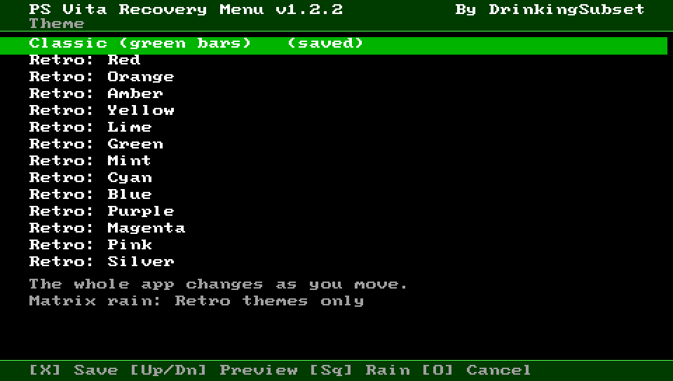
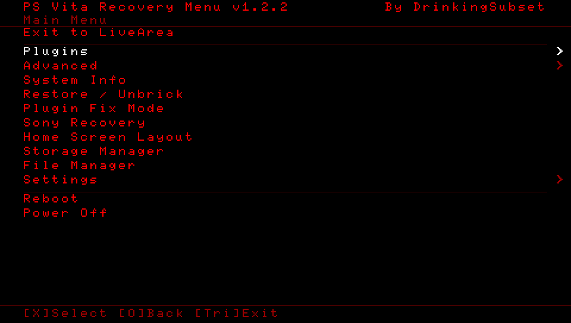
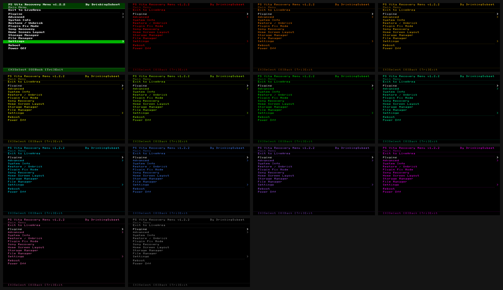
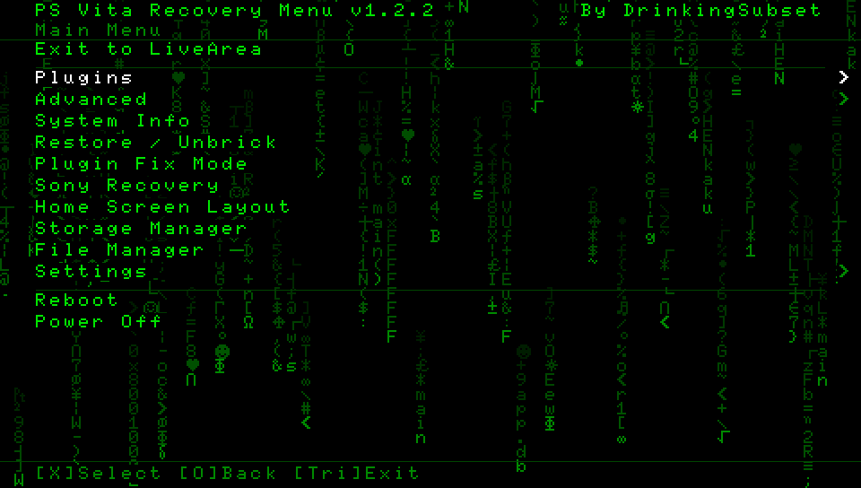
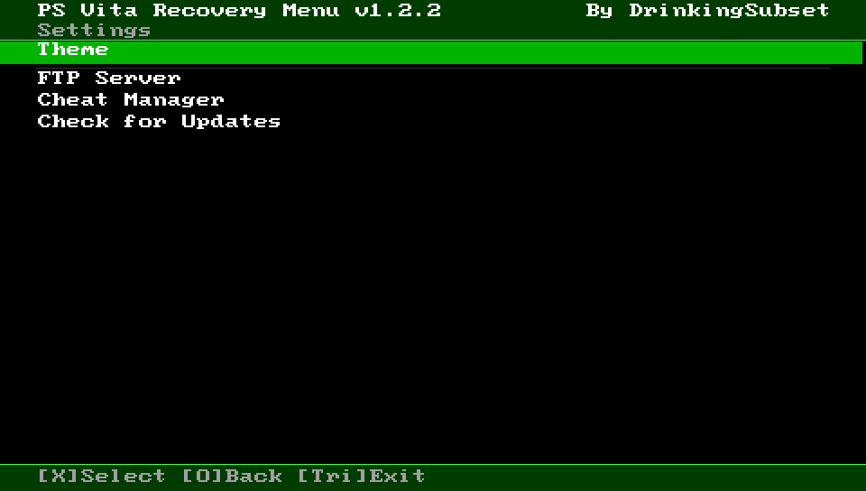
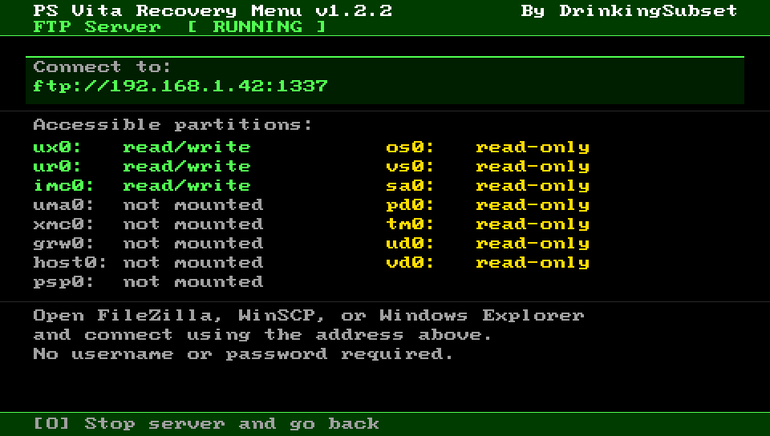

**Themes.** Give the recovery menu a different look, including a PSP M33-style Retro theme.

- **New Settings menu** on the main menu (above Reboot). It holds the new Theme screen, and **FTP Server, Cheat Manager and Check for Updates** moved into it, so the main menu keeps the recovery tools. Advanced keeps only system tools.
- **Settings > Theme:** choose **Classic** (the normal green look) or **Retro**, an M33 recovery style: black screen, the PSP debug font, all text in one colour and the selected row in white, with no bars. Retro colours: Red, Orange, Amber, Yellow, Lime, Green, Mint, Cyan, Blue, Purple, Magenta, Pink, Silver.
- The whole app changes as you move through the list (live preview). **X** saves, **O** puts the saved theme back. Saved in `ux0:data/vita_recovery/theme.cfg`; delete that file to go back to Classic.
- **Matrix Rain (Retro themes only):** turn it on or off with **Square** on the Theme screen (saved with the theme when you press X). Falling letters, digits, coding symbols, PSP-font extras (Greek / maths signs, card suits) and whole code words such as `sceIoOpen`, `0x80010002`, `*KERNEL`, in a dim shade of the theme colour. It falls behind every screen, and each line of text gets a black backing so the rain never runs through words. It pauses while the app is busy working.
- Every screen follows the theme. OK / warning / error colours (green / yellow / red) keep their meaning in every theme.
- The PSP font comes from pspsdk (BSD license, see `THIRD_PARTY_NOTICES.txt`).
- **Fix:** closing a tool with **O** (Theme, FTP Server, Cheat Manager, Check for Updates, and every other full-screen tool) could also take the menu back one more level, for example from Settings straight to the Main Menu. A button still held when a tool closes no longer counts as a new press.
- **Fix: FTP Server screen.** The drive list ran off the bottom of the screen, so the last drives and the connection tips were cut off. Drives are now shown in two columns, each marked **read/write** (green), **read-only** (yellow, system drives) or **not mounted**.
- No boot plugin changes: just install the VPK.

## Screenshots

## Install
Install `VitaRecovery_v1.2.2.vpk` with VitaShell. No boot plugin changes, so you do **not** need to reinstall Boot Recovery. "Enable Unsafe Homebrew" must stay ticked in HENkaku Settings.

Tested on PS Vita 2000 (3.65 Ensō) and PCH-1101 3G (3.60 and 3.65 Ensō), all with SD2Vita.
